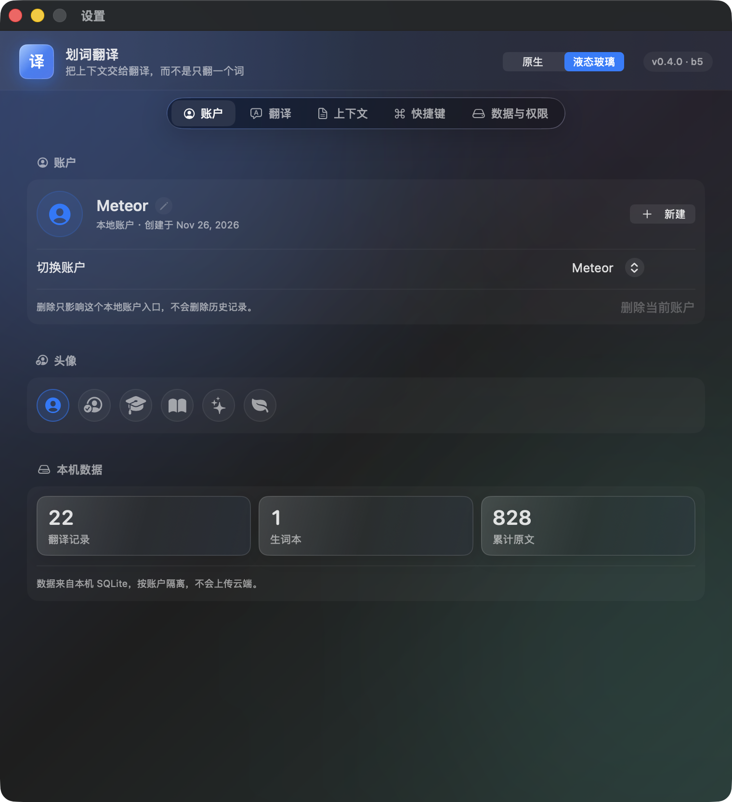
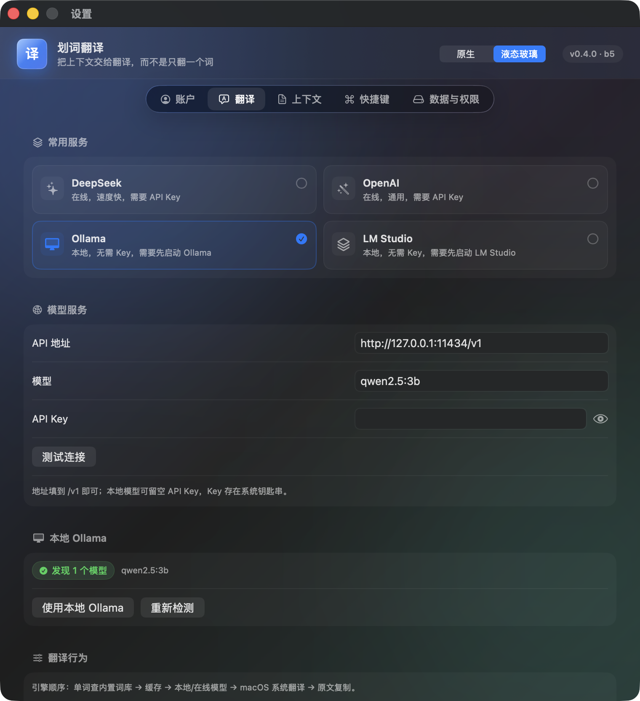
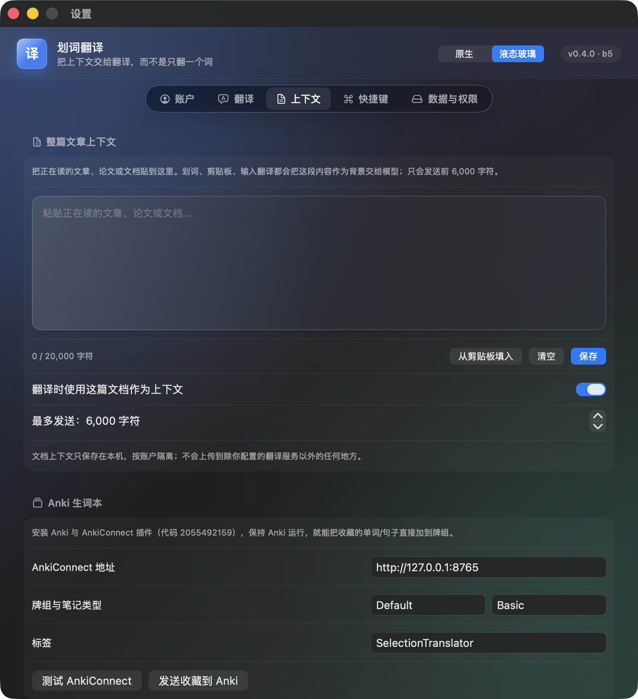
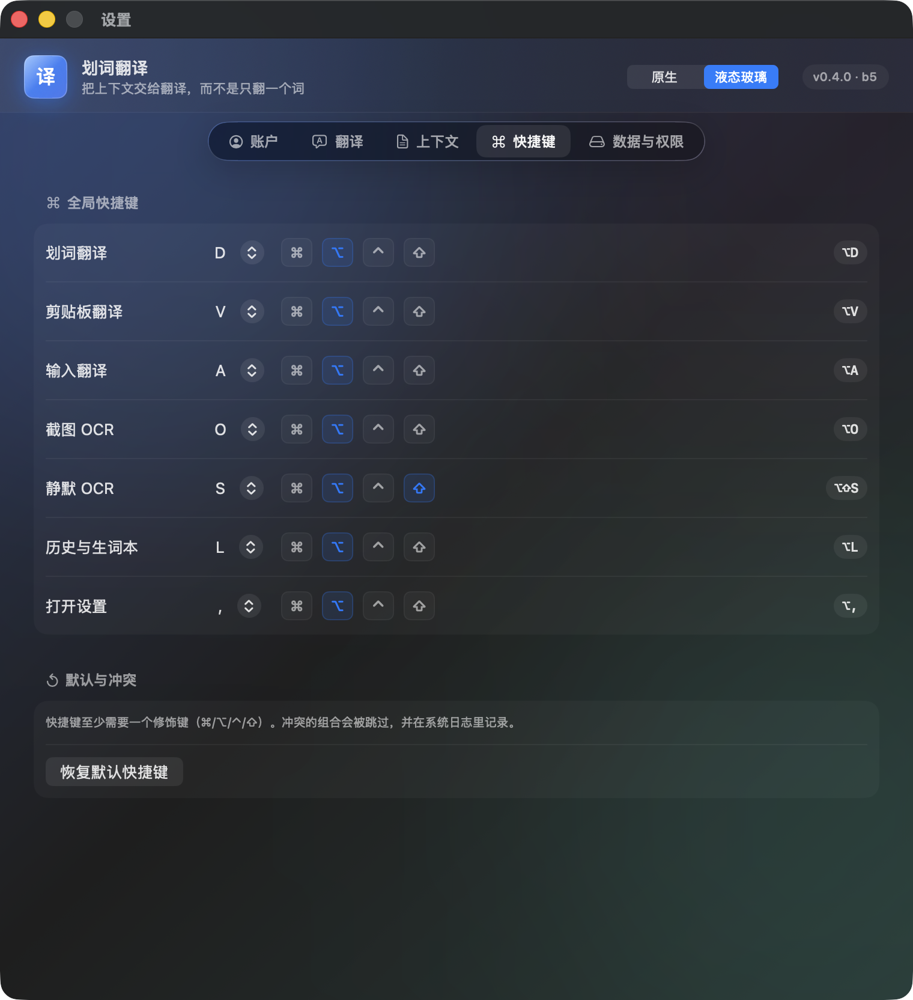
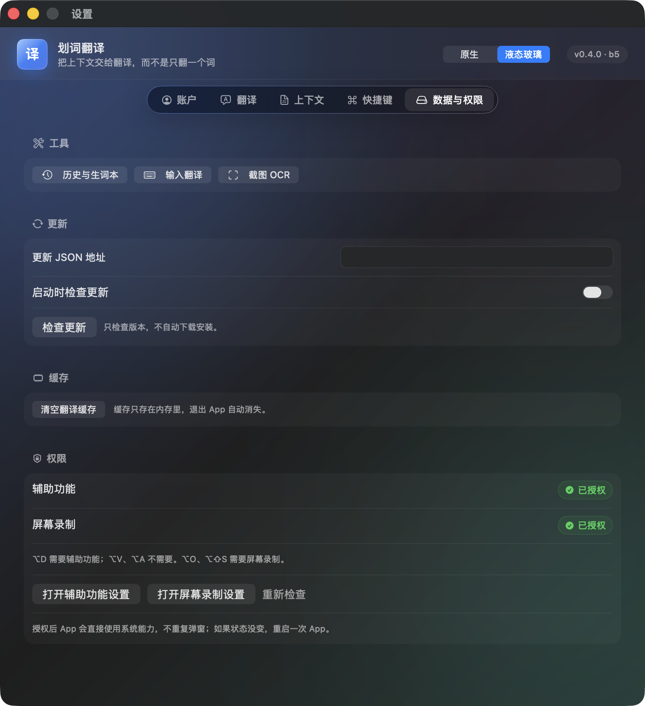
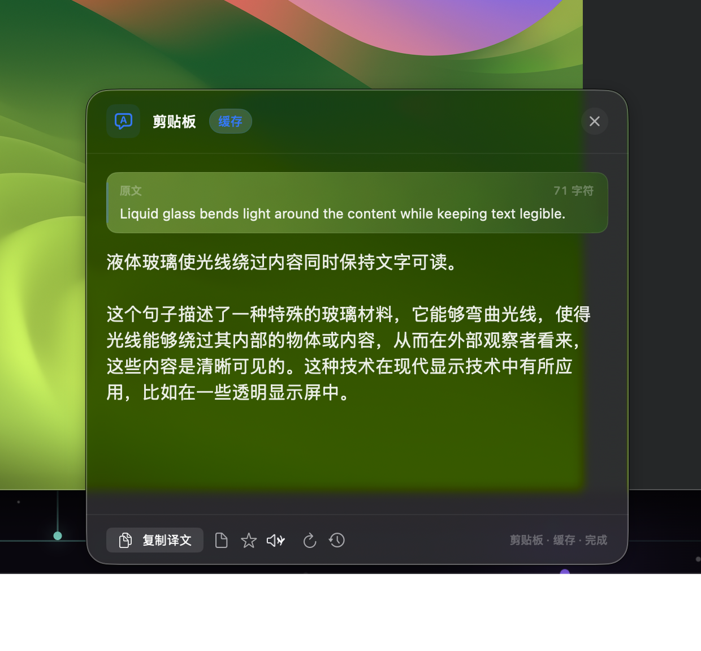
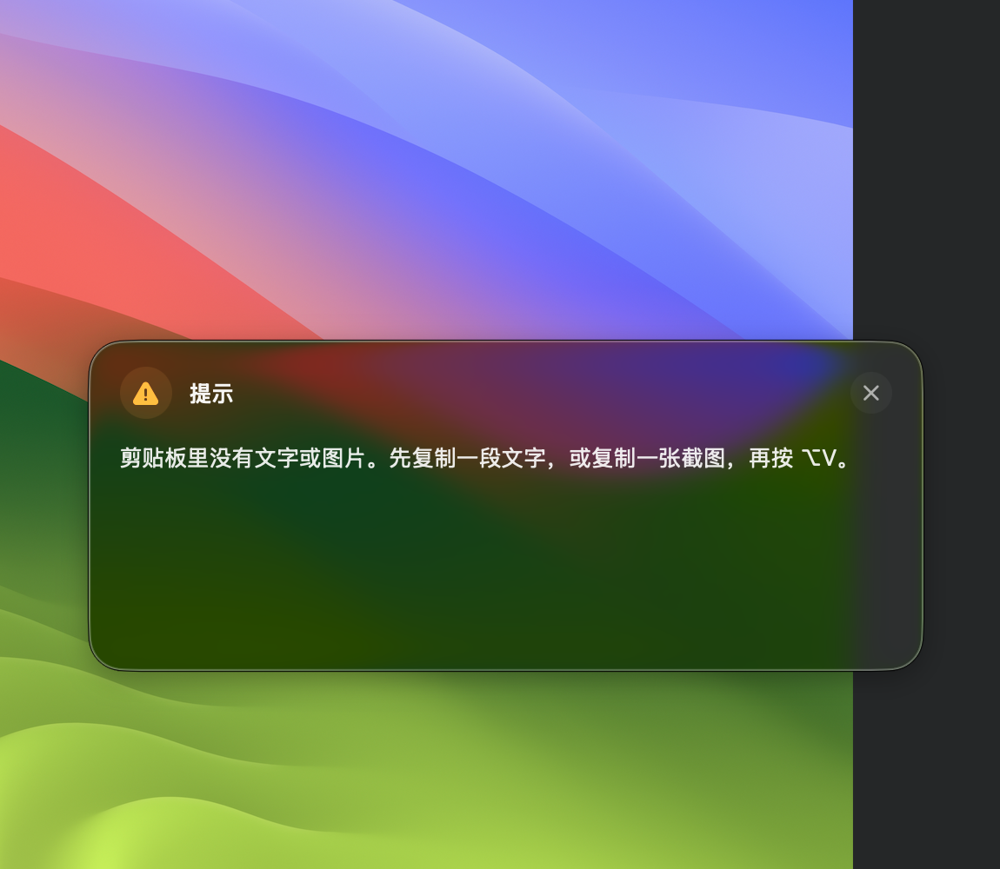
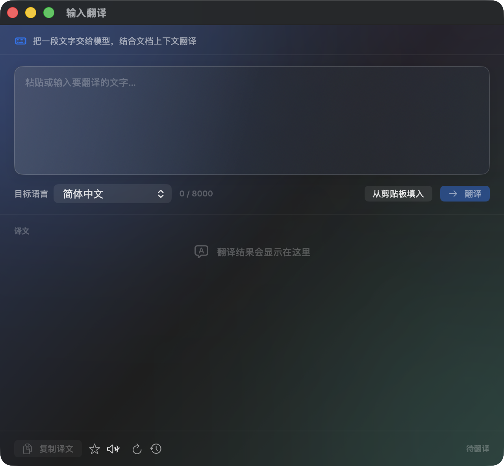
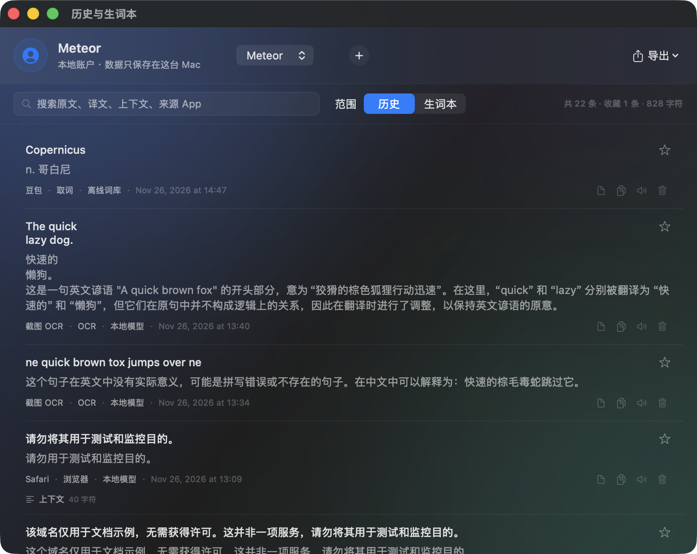

# 液态玻璃主题

状态：已实现并通过构建、迁移测试和界面验收。原生主题仍是默认外观，液态玻璃是新增的第二主题，不改布局、功能和数据格式。

## 为什么不是换一张壁纸

液态玻璃不是把窗口底色改成蓝紫渐变就结束。这个主题真正改变的是**材质的层级关系**：

1. **窗口先有环境。** 设置、输入、历史窗口共用 `STWindowBackdrop`：低饱和蓝/青/紫渐变叠加三团模糊色斑，颜色随浅色/深色模式调整。窗口不再是纯灰底，后面的半透明表面才有东西可“透”。
2. **导航和控件是玻璃。** 设置 tab bar 用 `STGlassCapsule` 包成一颗悬浮胶囊，选中项用 accent 淡染；服务卡、状态徽章、统计 tile、编辑器都用系统材质加顶部高光，而不是实色卡片。
3. **内容仍然可读。** 表单正文、输入框、列表正文没有被做成全透明。玻璃只出现在外壳和关键控件上，正文保留足够的对比度。
4. **浮窗是真的系统玻璃。** macOS 26 上使用 `glassEffect(.regular, in: RoundedRectangle(cornerRadius: 20))`，直接采样桌面和其他窗口；旧系统退到 `.ultraThinMaterial` + 高光描边，不牺牲可读性。

窗口级截图看不出桌面玻璃，因为它没有背景可采样。浮窗验收以实际桌面上的全屏截图为准确。

## 主题开关与迁移

- `AppAppearance` 只有两个值：`native`（原生）、`liquidGlass`（液态玻璃）。
- `AppSettings.appearance` 默认 `.native`；旧设置 JSON 没有这个字段时，`decodeIfPresent` 回退到 `.native`，不会把老用户的界面突然换掉。
- 设置页品牌头右侧是 `原生 / 液态玻璃` 的 segmented Picker；切换后写入 `SelectionTranslator.settings`，并马上重绘当前窗口。
- 主题通过 `EnvironmentValues.stAppearance` 往下传，不在每个 View 里散落 `if` 判断。根视图只需 `.stAppearance(store.settings.appearance)`。
- 切换使用 `.animation(.easeInOut(duration: 0.22), value:)`，只做轻过渡，不做弹簧或夸张缩放。

## 覆盖范围

| 区域 | 液态玻璃处理 |
| --- | --- |
| 设置窗口 | `STWindowBackdrop` 环境背景；玻璃 tab bar；品牌头、分组标题、统计 tile、服务卡、编辑器、搜索框材质化；Form 的 `scrollContentBackground` 隐藏，让环境透出来 |
| 翻译浮窗 | `STPanelSurface` 用 macOS 26 原生 `glassEffect`；原文块、语境解释块半透明；错误/权限面板也读同一主题 |
| 输入翻译 | 根背景换成 `STWindowBackdrop`；大编辑器用 `stEditorSurface()` 的液态分支，带顶部高光和 focus ring |
| 历史与生词本 | 根背景、账户头、搜索框、列表容器统一材质；列表正文保持清晰分隔，不把每条记录做成玻璃卡 |
| 提示面板 | 错误、权限提示都走 `STPanelSurface`，圆角、描边、阴影与浮窗一致 |

## 截图

设置 5 个 tab：

浮窗与提示面板。这里保留桌面背景，才能看到玻璃对背景的采样：

输入与历史：

## 验收

- `./scripts/build.sh`：**BUILD SUCCEEDED**，最终 App 签名 `Apple Development（本机开发签名）`
- `xcodebuild test ...`：**TEST SUCCEEDED**，13 个 XCTest 用例全部通过
- 新增 `AppAppearance` 迁移测试：旧 JSON 缺字段回退 `.native`；液态玻璃编码/解码 round-trip
- 测试截图使用 22 条真实历史记录和 828 字符累计原文；测试产生的临时记录已按原文和 id 清掉

## 边界

- 原生主题仍是默认，液态玻璃只改变材质和视觉，不改变窗口尺寸、功能、快捷键和数据格式。
- macOS 26 使用系统 `glassEffect`；macOS 14/15 使用材质 + 高光描边 fallback，外观接近但不具备系统级桌面折射。
- 版本已 bump 到 `0.4.0 / build 5`；GitHub Release 会包含本主题的 App 包和源码包。
- 权限面板需要撤销屏幕录制权限才能真实触发，本轮只截了错误提示面板；两者共用同一 `STPanelSurface` 和主题注入路径。
- 主 App 仍没有自定义 `AppIcon`；要延伸到 Dock/Finder 需要另做图标资产。
