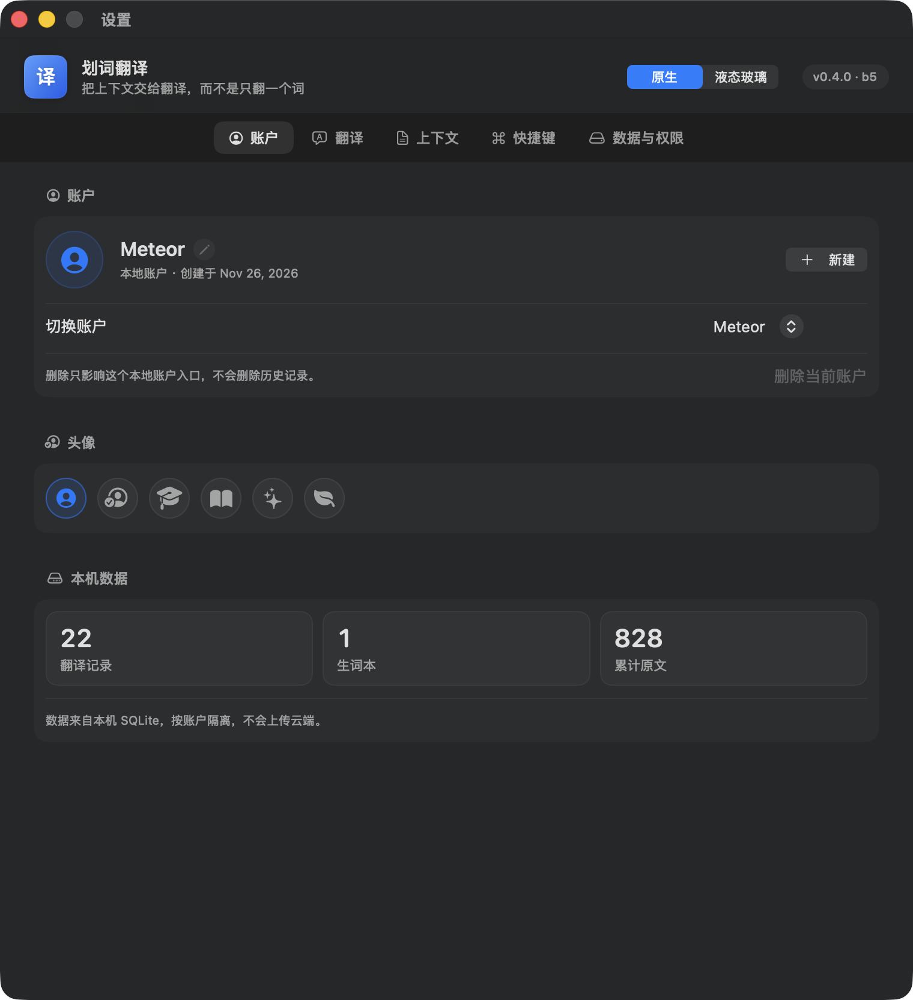
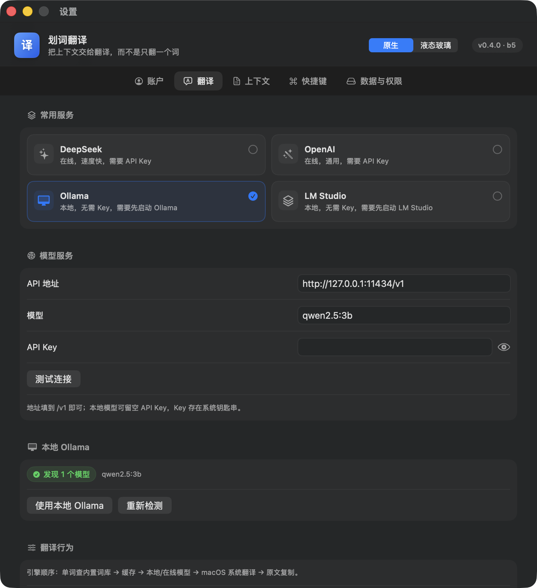
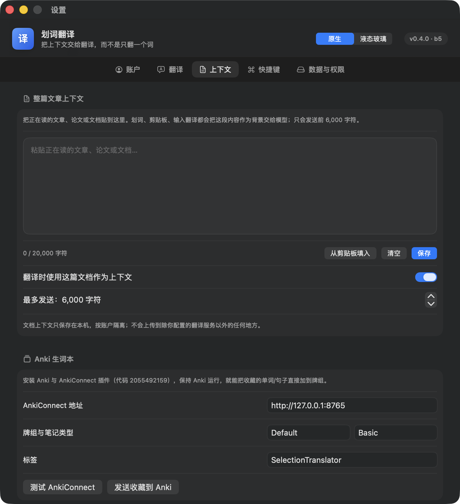
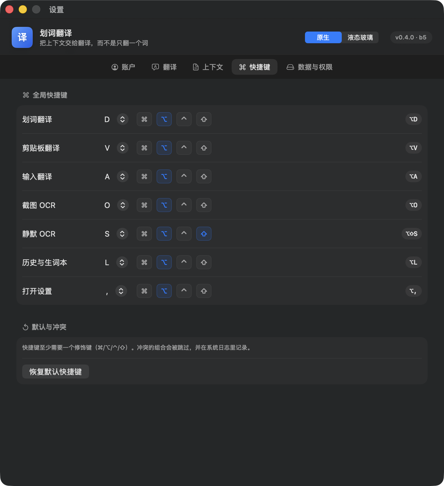
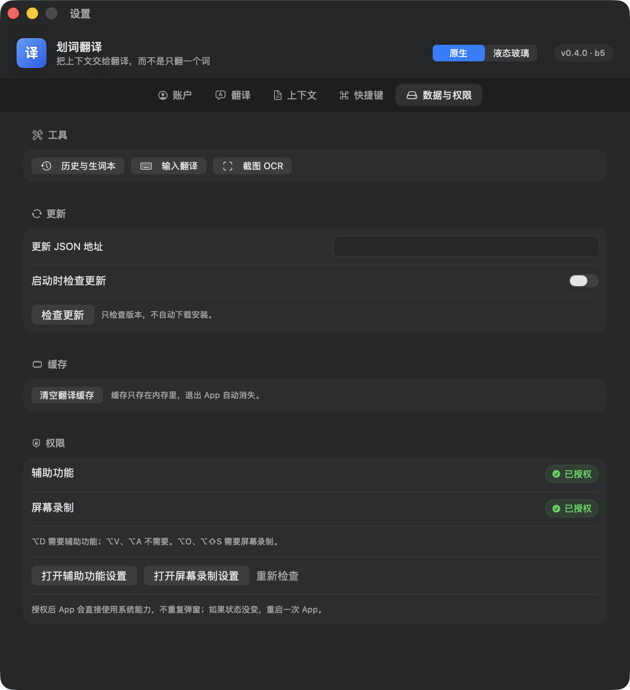
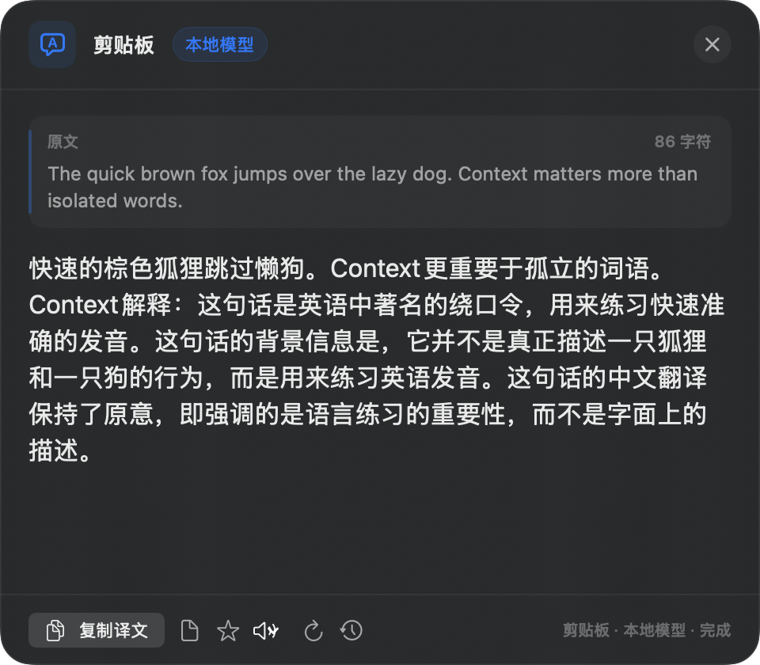
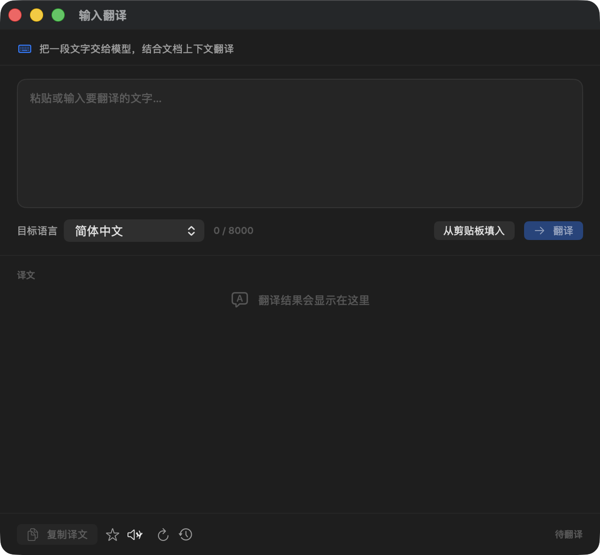
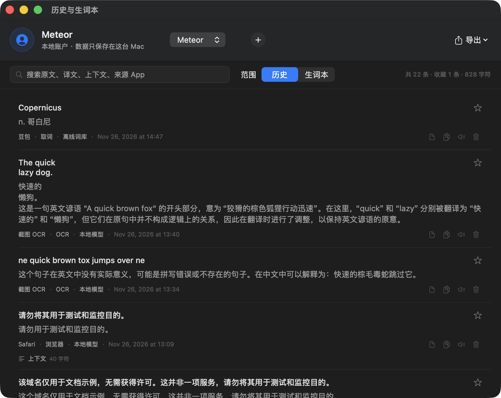
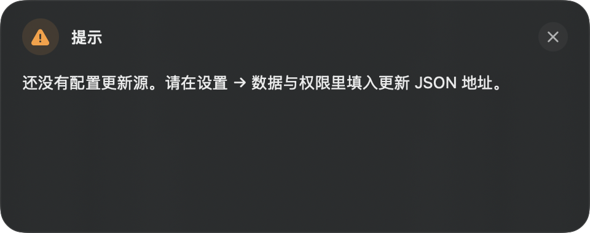

# UI 重做：向 macOS 原生视觉语言靠近

状态：视觉系统与四个主要界面已完成落地，编译、截图与回归测试通过。原生主题仍是默认外观；2026-11-26 又新增了可切换的液态玻璃主题。功能逻辑和默认设置未改。

## 设计目标

这次不是换一套颜色，而是把“信息层级、留白、材质、控件形态”统一起来：

1. **先内容，后装饰。** 主要靠字号、字重、间距和分组来建立层级，不用到处描边。
2. **材质要克制。** 原生主题里浮窗使用系统材质与圆角，设置/历史/输入窗口保持窗口底色；需要更多玻璃感时，只通过可切换的液态玻璃主题整体打开，不把零散毛玻璃堆在原生界面里。
3. **控件像 macOS。** Form、Picker、Toggle、Stepper、Segmented Control 保留系统行为；自定义只用在品牌头、服务卡、状态徽章、统计块和设置页 tab bar。
4. **一个品牌标记。** 统一使用蓝色“译”品牌块，不再在多个窗口重复不同风格的图标。

## 两套外观

设置页品牌头右侧提供 `原生 / 液态玻璃` 的切换。两套主题共用布局、字号和组件位置，只改变材质和环境：

- **原生（默认）**：窗口使用系统底色，卡片使用低对比实色表面，浮窗使用系统材质。原来的视觉不动。
- **液态玻璃**：窗口铺蓝/青/紫环境渐变，tab bar 变成玻璃胶囊，卡片、统计块、编辑器、搜索框和浮窗改用半透明材质、高光描边和柔和阴影。macOS 26 的浮窗直接调用系统 `glassEffect`，旧系统回退到材质方案。

主题保存在 `AppSettings.appearance`；旧设置没有该字段时回退 `native`。完整说明、实现细节和液态玻璃截图见 [`liquid-glass.md`](liquid-glass.md)。

## 视觉系统

新增 `Sources/SelectionTranslatorApp/DesignSystem.swift`，集中定义：

- `STTheme`：设置窗口 760×800、卡片圆角 12、浮窗圆角 20
- `STBrandMark`：蓝色渐变“译”标记
- `STSectionHeader`：带 SF Symbol 的分组标题
- `STStatusBadge`：授权、连接、模型状态
- `STStatTile`：账户页的本机数据统计
- `STAppearance`：原生 / 液态玻璃两套外观的 environment key
- `STWindowBackdrop` / `STHeaderSurface`：窗口环境背景与品牌头/历史页头表面
- `STGlassCapsule`：设置页 tab bar 的系统玻璃胶囊
- `STPanelSurface`：原生系统材质 / 液态玻璃浮窗底板，20pt 圆角
- `stCardSurface` / `stEditorSurface` / `stFormSurface`：卡片、编辑器和 Form 的统一表面、focus ring 与液态 Form 背景

## 设置窗口

尺寸从 680×812 调整为 **760×800**。设置页不再依赖系统 `TabView` 的窗口工具栏提升样式，而是在品牌头下方放一组轻量 tab bar：图标 + 文字，选中态是低对比胶囊；窗口标题栏保留“设置”，层级依次是窗口标题、品牌头、导航、内容。这样品牌头真正位于导航上方，也不会出现两个 tab 同时像被选中的视觉歧义。品牌头右侧新增外观切换，版本胶囊保持在最右。

- **账户**：头像、账户名、改名铅笔、切换账户、新建入口合并成一张账户卡；头像选择独立分组；底部三张统计 tile 展示翻译记录、生词本、累计原文。
- **翻译**：四个服务改成 2×2 服务卡，选中态用蓝色描边与勾选；模型服务输入框右对齐，API Key 支持显隐；Ollama 检测和翻译行为分组保留。
- **上下文**：整篇文章编辑器有 focus ring 和占位提示；字符计数、填入/清空/保存放在编辑器下方；Anki 配置与测试、发送按钮放在独立分组。
- **快捷键**：修饰键改成可点选的方形 chip；右侧显示当前组合的胶囊；默认/冲突说明单独分组。
- **数据与权限**：工具入口从三行大按钮改成一行紧凑按钮；权限状态用绿色徽章；未授权时才显示“请求屏幕录制权限”。

以上为原生主题；液态玻璃下的同一组页面见 [`liquid-glass.md`](liquid-glass.md)。

## 翻译浮窗

尺寸调整为 **480×420**，`NSPanel` 改为 **borderless + 透明 + 系统材质**，由 SwiftUI 自己裁 20pt 圆角；关闭、重试等按钮在无边框面板里仍可点击。

- 头部：品牌图标、App/来源、引擎徽章、关闭按钮
- 原文：低对比引用块，左侧细蓝线，显示字符数
- 译文：16pt 正文，支持选择与滚动
- 语境解释：独立的淡蓝卡片，不再与译文混在一起
- 上下文/文档上下文：可折叠，显示字符数
- 底部：复制译文、复制原文、收藏、朗读、重试、历史；状态文案收敛到右侧

## 输入翻译窗口

尺寸调整为 **640×560**。为避免标题栏和内容区重复显示“输入翻译”，去掉内容区的大标题，只在标题栏保留窗口标题；内容区顶部保留一行说明。

- 目标语言、字符计数、剪贴板填入、翻译按钮排成一条 action bar
- 结果区空状态有独立占位，不再是一片空白
- 底部操作与浮窗统一

## 历史与生词本

尺寸调整为 **820×620**，最小 780×560。

- 顶部是账户头和新建入口，导出菜单放在右侧
- 搜索、范围切换、统计摘要合并成一条 filter bar
- 列表去掉逐行卡片底色，改为轻分隔线；来源、引擎、时间用 10pt 次级信息
- 收藏、复制、朗读、删除保留在行尾，弱化但可发现

## 提示与权限面板

统一使用 `STPanelSurface` 和同一套头部：图标、标题、关闭按钮、正文、底部按钮。没有动作的错误面板收窄到 **480×190**；有动作时保留 240，避免大块空白。

## 验收

- `./scripts/build.sh`：**BUILD SUCCEEDED**，最终签名 `Apple Development（本机开发签名）`
- `xcodebuild test ...`：**TEST SUCCEEDED**，13 个 XCTest 用例全部通过；新增 `AppAppearance` 旧数据回退与 round-trip 测试
- 所有截图来自当前构建，保存在 `docs/screenshots/ui-*.png`；液态玻璃截图以 `ui-liquid-*.png` 保存

## 边界

- 功能、默认设置、快捷键、数据格式均未改；这次只改视觉与窗口尺寸。原生主题是默认外观，液态玻璃是新增主题。
- 版本已 bump 到 `0.4.0 / build 5`；GitHub Release 会带上新的 App 包和源码包，Developer ID 公证仍受外部条件限制。
- 主 App 仍没有自定义 `AppIcon`；如果要把“品味”延伸到 Dock/Finder，下一步应做图标资产。
- 权限面板与错误面板共用同一套头部和按钮，代码已完成；本轮只截了错误面板，权限面板要撤销屏幕录制权限后才能真实触发，未单独截图。
- Anki 真实连接、Developer ID 公证、Sparkle 自动更新仍受外部条件限制，不属于这次 UI 范围。
